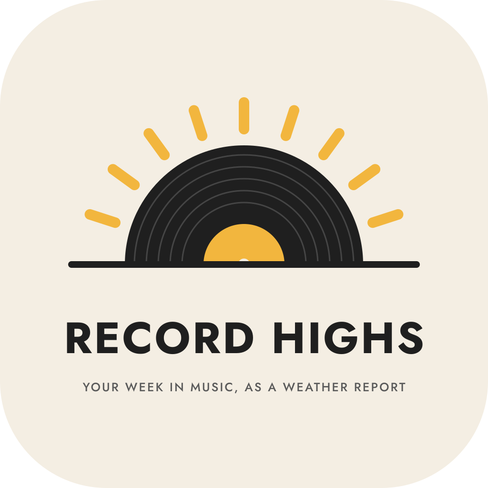
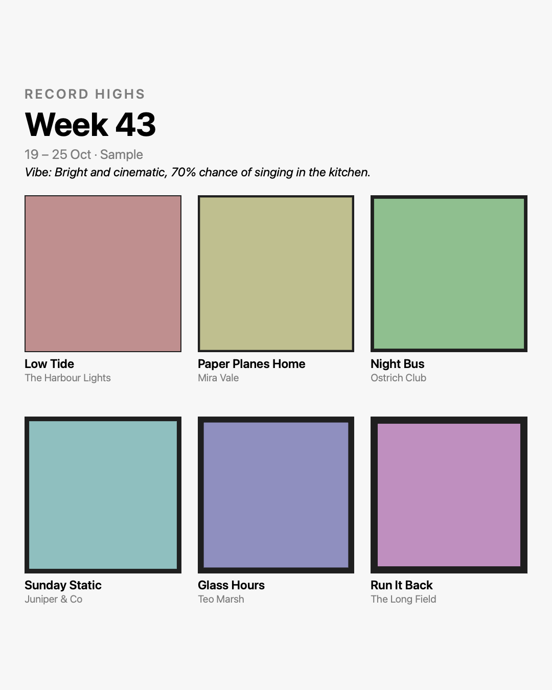

# Record Highs

*Your week in music, as a weather report.*

A small macOS app by [Saielle DaSilva](https://intentionaut.com) that turns six songs into a weekly music recap: a 3x2 grid of album covers, a one-line vibe forecast worked out from their genres, and the week's dates. It exports a 1080x1350 PNG for Instagram, LinkedIn or Bluesky, with the post text and alt text ready to paste into Buffer. It never posts for you.

Built in Swift and SwiftUI for macOS 14 and later, with no dependencies. Apple Music is the only player in v1; other players are a later item.

## Commands

| Command | What it does |
| --- | --- |
| `make app` | Builds `build/Record Highs.app` |
| `make install` | Copies the app to `/Applications` |
| `make test` | Runs the unit tests (vibe, layout, alt text, saving) |
| `make check` | Builds, then checks the promises below |
| `make samples` | Redraws the sample poster with placeholder covers |
| `make icon` | Redraws `AppIcon.icns` from `assets/icon.svg` (needs `rsvg-convert`) |

## Using it

- **Start from Apple Music.** At the top, **Fill from my week** fills the empty slots with your most played tracks of the last 7 days, then your Shazams (if Shazam saves to Apple Music). **Add now playing** puts the current track in the first empty slot. Library tracks only, and nothing leaves your Mac.
- **Paste a list.** One song per line, as `Title - Artist` or `Title by Artist`, numbered or not. It works from any source, including a Shazam history or a Buffer caption from an earlier week, and nothing leaves your Mac. Apple Music only logs plays of songs in your library, so this is the way in for streamed songs.
- **Or add songs by hand.** Type a title and artist and drag a cover onto the slot, or turn on **Find cover** in Settings.
- **Read the vibe.** A one-line forecast such as "Overcast and dreamy, 70% chance of staring out of windows." Type over it, or press **Regenerate** for another.
- **Post it.** Choose a save folder once and the PNG saves itself after each change. **Open Buffer** copies the post text and opens Buffer in your browser; **Copy alt text** gives you an image description that covers every word on the poster.

Everything you enter is saved as you go, so quitting loses nothing. **Clear all songs** starts the six slots afresh (with one Undo); the week, dates and your name stay.

## Layout

- `Sources/RecordCore/` - the parts with no UI: vibe forecast, grid layout, post text, alt text
- `Sources/RecordCore/Style.swift` - frame colour and thickness, and the genre-to-weather table; edit this to change the wording
- `Sources/RecordHighs/` - the app: editor, poster, Apple Music, cover lookup, export
- `Tests/RecordCoreTests/` - unit tests
- `scripts/check-promises.sh` - the promise checks
- `assets/` - the logo and app icon (SVG); the lettering is outlined from Jost, which is under the SIL Open Font License
- `samples/` - the sample poster

## Promises

Each line is checked by `scripts/check-promises.sh`. It searches the source and inspects the signed app, so it is evidence rather than proof. The macOS sandbox and hardened runtime are what enforce the promises while the app runs.

- **No accounts, no analytics, no uploads.** *Check:* no analytics, telemetry, upload or POST code in the source.
- **The only network use is the optional cover lookup.** It is off by default. Each press sends the title and artist to the iTunes Search API (`itunes.apple.com`), then downloads the one artwork image it names from `*.mzstatic.com`. That is two requests per press, because the search result names the image but does not contain it. Dropped covers must be files on your Mac; a link dragged from a browser is ignored, not fetched. *Check:* network code exists only in `CoverLookup.swift`, those are the only hosts, every `contentsOf:` read is a local file, the setting defaults to off, and the app has the network entitlement for this alone.
- **Apple Music is read, never changed.** The Apple Events entitlement is limited to `com.apple.Music`. *Check:* the signed app's exception names Music and nothing else.
- **Covers stay on your Mac.** *Check:* the only network code is the lookup above, which sends text, not images.
- **Nothing is written except your poster, your week and settings.** The app can write only to the folder you choose and its own container. File names are made from the week label's letters and digits only, so a label can't point outside the folder. *Check:* file writes exist only in `Export.swift` and `Store.swift`, and every export name goes through `fileStem`.
- **No way in for other code.** The app is signed with the hardened runtime, and the developer options (`--samples`, `--render`) exist only in debug builds. *Check:* the signature carries the runtime flag, and the release app contains no developer code.
- **Buffer is opened, never contacted.** *Check:* `publish.buffer.com` appears only in a call that opens your browser.

## Who made it

Record Highs is made by Saielle DaSilva at [Intentionaut](https://intentionaut.com): product, design, data and AI.

## Support

Record Highs is free to use for non-commercial purposes. Tips go toward the time I spend building and maintaining it: [ko-fi.com/intentionaut](https://ko-fi.com/intentionaut)

## License

Source available for non-commercial use.

- **Code:** [PolyForm Noncommercial 1.0.0](https://polyformproject.org/licenses/noncommercial/1.0.0). Use it, change it and share it for anything that isn't commercial. See `LICENSE`.
- **Sample poster and docs:** [CC BY-NC-SA 4.0](https://creativecommons.org/licenses/by-nc-sa/4.0/). Credit Saielle DaSilva, non-commercial, share alike. See `LICENSE-CONTENT.md`.

For commercial use, get in touch through [intentionaut.com](https://intentionaut.com).
